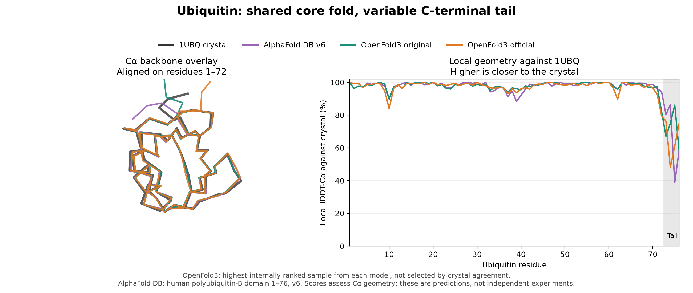

# Ubiquitin: OpenFold3, AlphaFold Database and the crystal structure

24 October 2026

The original and current official OpenFold3 models both recover the ubiquitin core closely. Across their five samples, median core Cα RMSDs against the experimental structure are **0.36 Å** and **0.41 Å**, respectively. Local lDDT-Cα scores against the crystal are **97.30%** and **95.94%**. This small, familiar target is a useful structural check, not evidence of a general accuracy ranking.

## References and sequence matching

The experimental reference is [1UBQ](https://www.rcsb.org/structure/1UBQ), the 1.8-Å crystal structure of human ubiquitin. Its 76-residue protein sequence exactly matches the benchmark input. Waters are excluded.

The AlphaFold Database API returned **version 6**, with model date **1 August 2025**, as the latest public version for human [polyubiquitin-B, P0CG47](https://alphafold.ebi.ac.uk/entry/P0CG47), and the [ubiquitin–ribosomal eL40 fusion, P62987](https://alphafold.ebi.ac.uk/entry/P62987), on the analysis date. The old standalone ubiquitin accession P62988 returned no current prediction. This comparison uses exact-sequence 76-residue domains within those precursor/fusion proteins; **they were not predicted as isolated mature ubiquitin chains**. Version 6 is a database model version, not an AlphaFold3 model designation or a fresh AlphaFold3-server calculation.

Every exact matching domain in the two selected entries is reported below, including all three polyubiquitin-B repeats. The first repeat was designated for the overlay before scoring; it was not selected for its agreement with the crystal.

## Agreement with 1UBQ

Local scores use all 76 residues. Core RMSD fits residues 1–72, separating the four-residue C-terminal tail. Full-chain RMSD uses all 76 residues. This secondary core summary is explicit because the original experimental report notes greater mobility/partial occupancy at the C terminus.

| Prediction | Local lDDT-Cα, all 76 residues ↑ | Core Cα RMSD, residues 1–72 ↓ | Full-chain Cα RMSD ↓ |
|---|---:|---:|---:|
| AlphaFold P0CG47, residues 1–76 | 96.42% | 0.40 Å | 1.70 Å |
| AlphaFold P0CG47, residues 77–152 | 95.95% | 0.42 Å | 1.60 Å |
| AlphaFold P0CG47, residues 153–228 | 96.95% | 0.39 Å | 0.88 Å |
| AlphaFold P62987, residues 1–76 | 96.94% | 0.42 Å | 0.76 Å |
| Original OpenFold3, median of five samples | 97.30% | 0.36 Å | 0.71 Å |
| Official OpenFold3, median of five samples | 95.94% | 0.41 Å | 1.21 Å |

Rows represent different prediction contexts and sample summaries, so no overall winner is inferred. The OpenFold3 samples all used seed 42, fixed saved MSAs and disabled templates. The AlphaFold entries were generated independently; their input alignments and protein context are not matched to our inference conditions.

Among the five original-model samples, full-chain RMSD ranged from **0.68–1.59 Å**; among the official-model samples it ranged from **0.69–1.82 Å**. Core RMSDs were **0.34–0.38 Å** and **0.37–0.58 Å**, respectively. The original samples' local lDDT-Cα scores spanned **96.68–97.52%**, and the official samples' scores **94.44–97.05%**. These ranges include every sample, not just the most favourable one.

Against AlphaFold P0CG47 domain 1 directly, the median OpenFold3 local agreement is recorded in the [individual result data](data/ubiquitin_structure_comparison_241026.json). This is prediction-to-prediction agreement; the table above uses the crystal as the experimental reference.

The overlay shows the highest internally ranked sample from each OpenFold3 model, rather than choosing by crystal agreement. Those selected samples are not the medians used in the table. All traces are superposed on experimental residues 1–72; local scores need no superposition. The tail shows greater variation than the core. AlphaFold coordinates are attributed to the AlphaFold Database/Google DeepMind and EMBL-EBI through the linked, versioned entries above; the experimental reference is Vijay-Kumar, Bugg and Cook's 1UBQ structure.

## Scope and reproducibility

The [metric implementation](../tools/structure_metrics.py) computes directional lDDT-Cα with a 15-Å inclusion radius and the 0.5/1/2/4-Å thresholds, averaged over residues. Coordinates were sequence-checked before scoring. The metric was checked for rigid-transformation invariance and sensitivity to a local displacement. Only Cα geometry is assessed; side-chain accuracy, ligand chemistry and clashes are not evaluated.

The [result record](data/ubiquitin_structure_comparison_241026.json) includes every sample/domain, local scores, RMSDs, ranking scores, the exact sequence, reference versions/dates and downloaded-file SHA-256 hashes. The per-residue arrays support independent inspection of the core and tail. The reference coordinates and metadata remain in the local audit and can be retrieved from the linked public databases.

Ubiquitin and its experimental structures are longstanding, widely used examples that may occur in model training data. This comparison should not be presented as an independent generalisation benchmark or as evidence that the older model is generally more accurate. The [six-example runtime study](official_model_performance_241026.md) compares performance separately from this structural assessment.
